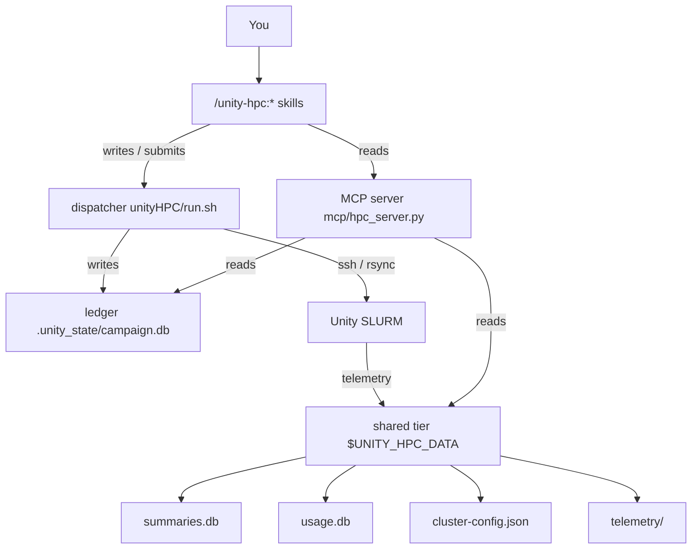
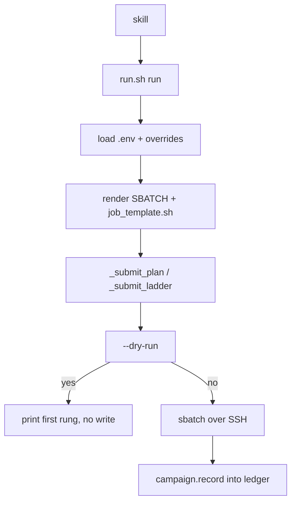
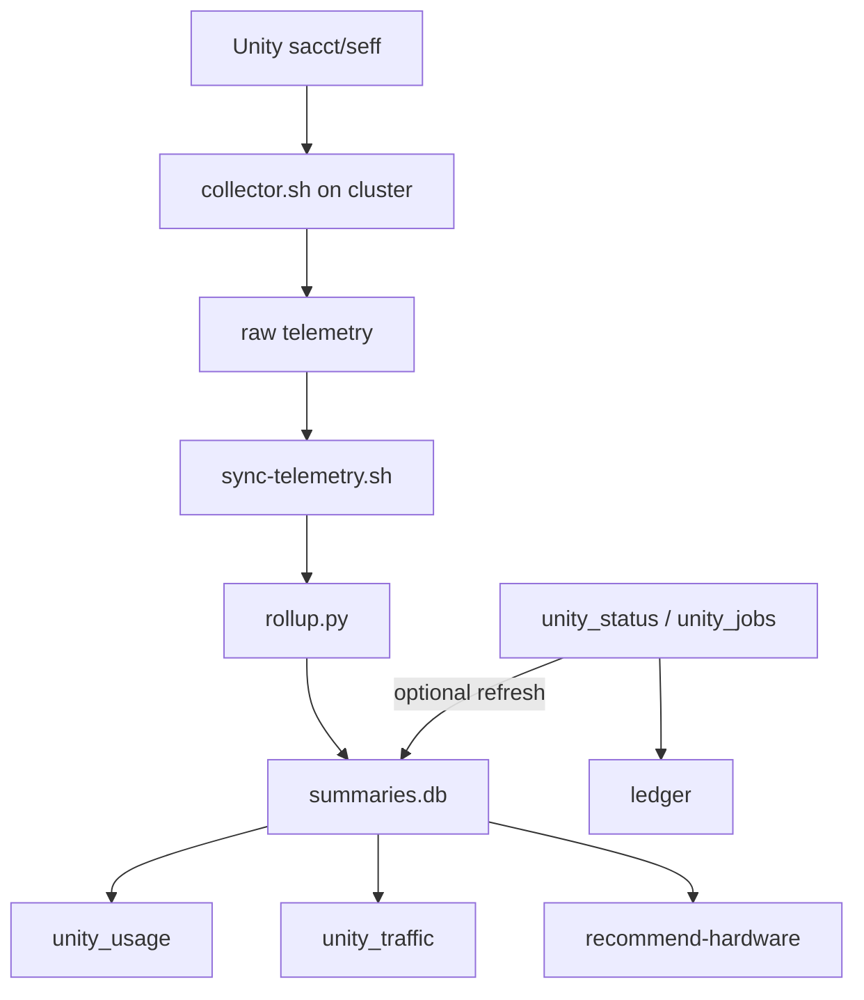

# unity-hpc

A local Claude Code plugin, in the `phd-agentic-tools` marketplace. It packages
the Unity HPC cluster workflow as coordinated skills, an MCP server, utility
scripts and autonomous agents. You run each skill as `/unity-hpc:<skill>`.

## Install

This plugin lives in the `phd-agentic-tools` marketplace at the repo root. Add the
marketplace with `/plugin` → Add Marketplace, or with these two commands:

```bash
/plugin marketplace add /home/ahm/Desktop/project/Research/tools/hpc-experiment-workflow
/plugin install unity-hpc@phd-agentic-tools
```

For local development, load the plugin directly instead of installing it. Your
edits then take effect on `/reload-plugins`, and there is no cache copy to keep in
step:

```bash
claude --plugin-dir .
```

A `--plugin-dir` copy takes precedence over the installed copy for that session,
so you can test a change without an uninstall.

The skills, the agents and the `unity-hpc` MCP server all register themselves. No
edit to `claude_desktop_config.json` is necessary. The MCP server runs under `uv`,
which resolves its one dependency (`mcp`) on the first run.

**Prerequisites:** `uv` on PATH, SSH access to Unity under the `unity` host alias,
and a `.env` in your project. `/unity-hpc:setup` generates that file at
`unityHPC/.env`.

Run Claude Code from your project directory. The MCP server reads the campaign
state from the working directory, unless you set `PROJECT_DIR`.

## The job lifecycle

One contract ties the whole plugin together: **`unityHPC/run.sh` records every job
it submits, and every management tool reads that record.**

```
run.sh run <exp>  ──sbatch──►  SLURM
       │                          │
       └── writes ────►  .unity_state/<campaign>.db   ◄── shared telemetry
                                  │                       (collector, ~15 min)
        ┌─────────────────────────┴─────────────────────────┐
   unity_status / unity_jobs / unity_my_jobs        run.sh status  (live sacct)
   unity_logs / unity_results                       run.sh logs / fetch
```

The [Pipeline](#pipeline) section has the layer map, the submit path, and the observe path.

| Command | Talks to the cluster? | Use it for |
|---|---|---|
| `run.sh run <exp> [--campaign N] [--dry-run]` | yes | submit a job, and record it |
| `run.sh jobs` | no | what this project has submitted |
| `run.sh status` | yes (one `sacct`) | the live state, written back to the ledger |
| `run.sh logs [-n N]` | yes | tail the newest job's output |
| `run.sh fetch` | yes (`rsync`) | pull this campaign's `.out`, `.err` and artifacts |
| `run.sh render <exp>` | no | preview the sbatch script |
| `run.sh sync` | yes (`rsync`) | push the project to `$REMOTE_DIR` |
| `run.sh array <manifest> [--campaign N] [--limit N]` | yes | fan out N independent tasks, one `sbatch --array`, N ledger rows |
| `run.sh cancel [--campaign N] [--job P]` | yes (`scancel`) | cancel every live job in scope, and mark it `CANCELLED` in the ledger |

You can override any of these for one invocation, with no edit to `.env`:
`JOB_COMMAND`, `WALLTIME`,
`SLURM_{PARTITION,CPUS,MEM,NODES,GPUS,GPU_TYPE,ACCOUNT,CONSTRAINT}`,
`SLURM_PARTITION_{FALLBACK,WALLTIME_CAP}`, `REMOTE_DIR`, `UNITY_HOST`,
`CAMPAIGN`, `MODULES`, `VENV_PATH`, `HF_HOME` and `USER_EMAIL`. The
caller's environment wins:

```bash
JOB_COMMAND="echo smoke-test" SLURM_MEM=1G SLURM_PARTITION=cpu bash unityHPC/run.sh run smoke
```

That is how you smoke-test a project whose real job is a four-hour GPU run. It is
also how you resize one retry without disturbing every other run.

On a shared cluster a rejected partition is routine. Give `run.sh` an ordered
list and it retries down it, clamping the walltime to each partition's ceiling:

```bash
SLURM_PARTITION_FALLBACK="cpu cpu-preempt ood-shared" \
SLURM_PARTITION_WALLTIME_CAP="ood-shared=08:00:00" \
  bash unityHPC/run.sh run smoke
```

Unset, the behaviour is a single attempt, exactly as before. Naming
`SLURM_PARTITION` yourself disables the ladder — a blank `SLURM_PARTITION=`
names nothing, so it does not. `run.sh jobs` reports the partition the job
actually landed on, and `--dry-run` previews the rung a real submit would try
first.

A **campaign** is a label that groups submissions. Its default is today's UTC
date. `cancel`, `fetch` and the watcher all take `--campaign N` and act on every
live group under that label; `--job <parent>` pins one fan-out group.

The ledger is local only, because `sync.sh` excludes it, and it upgrades in
place when a new plugin version adds a column.

A job submitted with bare `sbatch`, outside `run.sh`, is invisible to everything
above. That is the one thing the abstraction cannot do for you.

### Fan-out: manifest, payload and cancel

`run.sh array <manifest>` submits one `sbatch --array` for the whole batch, and
records N ledger rows keyed `<parent>_<index>`. A manifest line is `EXP` alone,
or `EXP<TAB>JSON`. The JSON tail reaches the task as `UNITY_TASK_PAYLOAD` — the
harness copies it and never parses it. A tab-free line keeps today's
`EXP`-only behaviour.

`run.sh cancel [--campaign N] [--job P]` runs one `scancel` over every live
job in scope, then writes `CANCELLED` back to the ledger. An array's children
collapse onto their parent job id, the id `scancel` understands.

### Remote bootstrap: `unityHPC/bootstrap.sh`

If `unityHPC/bootstrap.sh` exists, the job template sources it under one
`flock` on `REMOTE_DIR`. If that file is absent, the template does the plain
`VENV_PATH` activation instead.
The lock matters for fan-out: N array tasks start together and would
otherwise race each other setting up the same NFS-mounted environment. A
project that needs conda, modules, `HF_HOME` or scratch setup writes that once,
in the hook, and every task shares the lock.

### Watch: `scripts/hpc-watch`

`hpc-watch` is an opt-in, foreground process that you start on your own
machine and stop with Ctrl-C. Nothing starts it for you, and nothing
respawns it.

```bash
scripts/hpc-watch --campaign N [--job <parent>] [--poll SECONDS]
```

It polls `run.sh status`, retries a failed task within a budget, calls
`run.sh fetch` once every in-scope job is terminal, and exits. It never
opens the ledger, never calls `sacct`, and never calls `sbatch` — those stay
inside `run.sh`. One `flock` on `.unity_state/<campaign>.watch.json` allows
one watcher per campaign; a second one on the same campaign exits
immediately.

## Pipeline

The job lifecycle sketch is the contract in one picture. The three maps are the
layer map, the submit path, and the observe path.

### Layer map

Skills write and submit through the dispatcher on the left, and they read
through the MCP server on the right. The ledger is the contract: every
management tool reads the jobs that `run.sh` recorded.



### Submit path

Each submit loads `.env` and the caller overrides, then `render` writes the
`#SBATCH` header plus typed `job_template.sh` and walks the plan and ladder to
`sbatch`. `campaign.record` stores the partition that landed, not the first
request, and `--dry-run` prints that plan and writes nothing.



### Observe path

On the cluster, `collector.sh` writes raw telemetry from sacct and seff, and on
this machine `sync-telemetry.sh` and `rollup.py` fill `summaries.db`.
`unity_usage`, `unity_traffic`, and `recommend-hardware` read that database,
while `unity_status` and `unity_jobs` read the ledger and refresh from telemetry
with no SSH unless you ask.



## Metrics are declared, never assumed

This plugin serves every kind of SLURM job, so its core names **no** metric.
`unity_results` reports the numeric `key: value` lines each job printed, in the
order it found them, and it ranks nothing.

A project with a headline metric opts in with `unityHPC/metrics.json`:

```json
{
  "primary": "val_bpb",
  "goal": "min",
  "report": ["val_bpb", "peak_vram_mb", "mfu_percent"],
  "labels": {"peak_vram_mb": "vram_mb"}
}
```

| Field | Effect | If omitted |
|---|---|---|
| `primary` + `goal` (`min`/`max`) | names the best job | nothing is ranked |
| `report` | puts these columns first | discovery order |
| `labels` | renames for display only | the raw key names |

The tools still print a metric that a job prints but does not declare. To hide the real
output makes the report lie.

They also print each declared metric that no job printed. That is usually how you
learn that a run died early.

A malformed declaration degrades to the generic view, and says why.
`tests/test_contract.py` fails if any metric name reappears in `mcp/` or `lib/`.

## `hardware` is a device, not a queue

`task_run.hardware` records what a job **ran on**: a GPU type such as `a100` or
`titan_x`, `gpu:unspecified` when it held a GPU that sacct did not name, or `cpu`.
The queue lives in its own `task_run.partition` column.

`hardware` used to fall back to the partition string whenever the GPU type was
unknown. One column then mixed two taxonomies: `a100`, a device, sat beside
`gpu-preempt` and `gpu,gpu-preempt`, which are queues, and which were often a100s
themselves.

Anything that ranked by hardware — `task_profile`, `recommend-hardware` — was
therefore comparing buckets that were not comparable. The repair collapsed 84
distinct values to 17, and 22,070 jobs filed under `gpu` turned out to be a100s.

`cluster-intel/backfill_hardware.py` repairs an existing store. It re-derives every
row from the raw telemetry rather than guessing, and it leaves a row with no raw
record untouched. It reports the counts, and it is safe to re-run.

## When the behavior disagrees with the source

Call `mcp__unity-hpc__unity_doctor`.

The MCP server loads once per session. A plugin upgrade mid-session therefore
leaves the process serving the *old* code, while the files on disk show the fix.
That state is indistinguishable from a bug until you ask the running process what
it is.

`unity_doctor` reports its own version and source path. It flags code that changed
after start, and a version mismatch against `installed_plugins.json`. It also
prints the scaffold, ledger, metric and shared-data state. The cure is
`/reload-plugins`, or a session restart.

There is one case it cannot report on itself. A server from before 0.8.0 has no
`unity_doctor` at all. If the tool is absent, or answers `Unknown tool`, that *is*
the diagnosis: the session runs a pre-0.8.0 server, and needs a reload.

## Analysis dependencies — only for the cluster-intel scripts

The MCP server needs nothing beyond `mcp`. The `cluster-intel/*.py` scripts and
`scripts/hpc-usage` need heavier libraries:

```bash
uv pip install -r mcp/requirements.txt
```

## Symlink the scripts (optional)

```bash
chmod +x scripts/*
ln -sf "$(pwd)/scripts/"* ~/.local/bin/
```

## Skills

| Skill | Purpose |
|---|---|
| `/unity-hpc:setup` | Bootstrap a project — pick cpu, gpu, ml, multi-cpu or multi-gpu, generate `unityHPC/`, check SSH, sync |
| `/unity-hpc:run <exp>` | Submit one job to SLURM, queue-aware, for any job type |
| `/unity-hpc:sweep` | Submit a batch of related jobs under one campaign |
| `/unity-hpc:status` | Check the job states — an instant local read, with a live check on request |
| `/unity-hpc:fetch` | Fetch the job output and artifacts from the cluster |
| `/unity-hpc:resume` | Rebuild the context after a session reset |
| `/unity-hpc:log-result` | Record an experiment in results.tsv |
| `/unity-hpc:recon` | Profile the cluster — limits, partitions, GPU types, sacct scope, capacity |
| `/unity-hpc:recommend-hardware` | Rank GPU backends by your measured speed against availability |

## Agent scope

`agents/recon` does the same work as the `recon` skill, through the same locked
merge CLI. When a larger workflow has to run recon on its own, use this agent.

`agents/experiment-dispatcher` and `agents/result-analyzer` are optional personas
for an ML experiment loop. They expect a `program-unity.md` file, a metric declared
in `unityHPC/metrics.json`, and a short training budget. Each file states that
scope in its own header, and names the skill to use instead.

The core is general-purpose for CPU, GPU and ML SLURM jobs: the skills, the
dispatcher, the MCP server, the scaffold and the telemetry pipeline. A CPU project
or a non-ML project uses the skills directly.

`templates/CLAUDE.md.template` is a starting point, not a contract. Its
marks its project-specific lines, and a CPU project deletes them.

## Scripts (`scripts/`, symlink to `~/.local/bin/`)

| Command | Purpose |
|---|---|
| `hpc-status` | Campaign job counts from the local DB (exit 0=done 1=running 2=fail) |
| `hpc-results` | Print results.tsv, formatted |
| `hpc-usage` | Terminal plots of cluster usage (plotext), selectable by GPU and window |
| `hpc-tmux` | Manage the tmux sessions on the cluster |
| `hpc-logs` · `hpc-ssh` · `hpc-compare` · `hpc-cleanup` | small utilities |
| `hpc-scaffold` | Generate `unityHPC/{run.sh,job_template.sh,sync.sh,.env}` for a project type |

## cluster-intel — usage history and analysis

An authoritative, cluster-wide usage history from `sacct`, plus queue and GPU
telemetry, rolled up into `summaries.db`.

| File | Runs on | Purpose |
|---|---|---|
| `collector.sh` | cluster (tmux, singleton) | The sole cluster-side writer. It samples partitions, nodes, GPUs, queue and jobs every 15 min into `telemetry/*.jsonl`, and owns the 35-day retention prune |
| `sync-telemetry.sh` (`hpc-sync-telemetry`) | local | A locked, retention-aware pull of `telemetry/` into the shared data directory |
| `rollup.py` | local | Summarizes the raw telemetry into `summaries.db` (`hourly_resource`, `daily_resource`, `task_profile`) |
| `cluster-config.json` | local (shared) | Cluster limits, GPU types and capacity from `unity-hpc:recon`. One shared copy for every project, written through a merge |

**Where the shared data lives.** All local cluster-intel data lives in one
machine-wide directory. Every project shares it, and it sits **outside the
versioned plugin install**, so it survives a plugin update. That data is
`cluster-config.json`, `summaries.db` and `telemetry/`.

```
$UNITY_HPC_DATA        (default ~/.local/share/unity-hpc, honors $XDG_DATA_HOME)
├── cluster-config.json written by unity-hpc:recon
├── summaries.db        hourly_resource, daily_resource, task_profile (rollup.py)
├── telemetry/          synced raw collector output (hpc-sync-telemetry)
└── archive/            pre-redesign snapshot, read-only (dashboard only)
```

The plugin *code* is the versioned shared install, at `${CLAUDE_PLUGIN_ROOT}`. The
plugin *data* is this directory. Every script and tool defaults to it, and honors
`$UNITY_HPC_DATA`.

## MCP tools

`unity_status` · `unity_jobs` · `unity_results` · `unity_results_tsv` · `unity_submit`
· `unity_array` · `unity_cancel` · `unity_logs` · `unity_ssh` · `unity_traffic`
· `unity_usage` · `unity_cluster_profile` · `unity_my_jobs` · `unity_doctor`

## Cluster facts

- Host: Unity (UMass) · `ahmalik@umass.edu` · SSH alias: `unity`
- SLURM account: `pi_taqi_umass_edu`
- Storage: `/work/pi_taqi_umass_edu/ali/` — PI group, `ali/` reserved for the user

## See also

- `ARCHITECTURE.md` — the layer map, the submit path, the I1–I9 invariants, and
  the design rules
- `docs/design-decisions.md` — why the plugin has this shape, and what Unity does
  and does not expose
- `docs/gpu-test-envelope.md` — the limits for a GPU test job
- `cluster-intel/` — usage history collection and analysis
- `agents/` — the autonomous agent persona files

At the marketplace root:

- `docs/marketplace.md` — plugin naming, versioning, and how an update propagates
- `docs/open-follow-ups.md` — what is still open, and what triggers it
