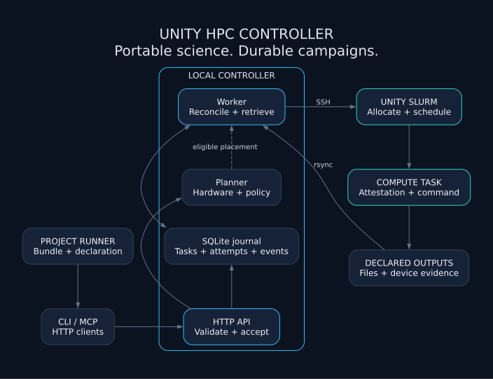
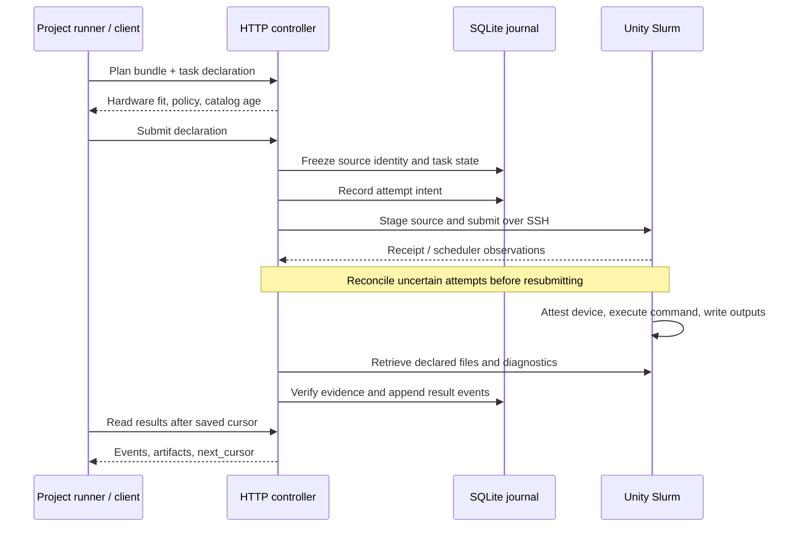

# Unity HPC Controller

**Portable experiment bundles. Exact hardware classes. Durable results.**

A headless Python controller for research campaigns on **Unity Slurm**.
Your project declares commands, resources, dependencies, and required files.
The controller preserves source identity, places tasks, reconciles attempts,
and retrieves results—even after the submitting client exits.

[](https://github.com/alirafiqmalik/unity-hpc-controller/actions/workflows/test.yml)
[](LICENSE)

[Quickstart](#quickstart) · [Documentation](docs/README.md) · [Architecture](ARCHITECTURE.md) · [Contributing](CONTRIBUTING.md)



## What the controller guarantees

| Capability | Behavior | Implementation |
|---|---|---|
| Frozen source | Snapshot the experiment bundle before execution; identical declarations reuse campaign identity. | [Declaration and bundle contract](controller/campaign_contract.py) |
| Hardware consistency | Persist a model class's GPU fingerprint and check assigned device evidence before accepting results. | [Hardware journal](controller/campaign_store.py), [Slurm attestation](controller/campaign_slurm.py) |
| Recoverable attempts | Persist submission intent before SSH; reconcile uncertain outcomes before another submission. | [Campaign worker](controller/campaigns.py) |
| Bounded recovery | Retry declared infrastructure failures within a durable budget; transfer retries do not repeat compute. | [Campaign lifecycle](controller/campaigns.py) |
| Incremental results | Require declared output files and expose durable result-event cursors. | [HTTP interface](controller/http.py), [result journal](controller/campaign_store.py) |
| Evidence-aware placement | Filter hardware and policy first, then rank compatible partitions using measured wait history. | [Planner](controller/campaign_planner.py) |

The project owns scientific methods and result interpretation. The controller
checks declared files and hardware evidence; Slurm owns allocation and start
times. Application failures require a new campaign. See the
[current contract](docs/adr/0009-headless-campaign-controller.md).

## Quickstart

You need access to Unity, Python (CI uses **3.12**), OpenSSH, and rsync.
The controller uses Python's standard library. The optional plugin's MCP client
also needs `uv`; its dependency is declared in [mcp/requirements.txt](mcp/requirements.txt).

### 1. Start the controller

```bash
git clone https://github.com/alirafiqmalik/unity-hpc-controller.git
cd unity-hpc-controller
scripts/hpc-controller --fg --no-tailscale
```

Keep that terminal open. The HTTP API listens on `127.0.0.1:8300` by default.
For persistent operation, follow the [user-service guide](docs/backend-campaigns.md#keep-the-service-running).

### 2. Configure cluster access

In a second terminal at the repository root, create a local `backend.json` with
your account's values. This filename is gitignored.

```json
{
  "account": "pi_yourlab_umass_edu",
  "ssh_host": "unity",
  "ssh_identity": "~/.ssh/unity_cluster_ed25519",
  "remote_root": "/work/pi_yourlab_umass_edu/<user>/unity-controller",
  "cpu_partitions": ["cpu", "cpu-preempt"],
  "allowed_partitions": ["gpu", "gpu-preempt"],
  "max_active_tasks": 4,
  "max_active_gpus": 1
}
```

```bash
scripts/hpc-campaign configure backend.json
scripts/hpc-campaign probe
```

Use the [SSH access guide](docs/guides/ssh-access.md) to establish noninteractive
access first. A missing or stale catalog blocks new submissions.

### 3. Plan, submit, and collect

The included [CPU example](examples/cpu-result/) writes a small JSON result.
Its declaration uses the same contract as a project's runner:

```json
{
  "schema_version": 1,
  "campaign_id": "cpu-result-example",
  "bundle": {"path": "examples/cpu-result"},
  "max_concurrent": 1,
  "max_attempts": 2,
  "tasks": [{
    "task_id": "summarize",
    "argv": ["python3", "task.py"],
    "resources": {
      "gpu_count": 0, "cpus": 1,
      "memory_mb": 1024, "walltime_seconds": 300
    },
    "outputs": ["result.json"]
  }]
}
```

```bash
scripts/hpc-campaign plan examples/cpu-result/campaign.json
scripts/hpc-campaign submit examples/cpu-result/campaign.json
scripts/hpc-campaign watch cpu-result-example
scripts/hpc-campaign results cpu-result-example
```

Planning is read-only. Submission permits cluster work. The bundle path must
exist on the **controller machine**; this example assumes the controller started
at the repository root. For a remote controller, use a source path on that
machine and select its address with `UNITY_CONTROLLER` or `--url`.

Results include events and artifact identities. Save `next_cursor` and pass it
to `results --after` to resume. See [the HTTP and artifact contract](docs/backend-campaigns.md)
for retrieving files and declaring GPU tasks or dependencies.

## How a campaign moves through the system



State lives outside the installation under `$UNITY_HPC_DATA`: a campaign journal,
immutable bundles, retrieved artifacts, and a separate telemetry archive.
See [architecture](ARCHITECTURE.md) for stores and recovery boundaries.

## CLI and agent clients

| Interface | Entry point | Role |
|---|---|---|
| Service | [`scripts/hpc-controller`](scripts/hpc-controller) | Run the persistent controller |
| CLI | [`scripts/hpc-campaign`](scripts/hpc-campaign) | Configure, plan, submit, watch, retrieve events, cancel |
| MCP | [`mcp/hpc_server.py`](mcp/hpc_server.py) | Expose the same HTTP operations to agent clients |
| Skills | [`connect`](skills/connect/SKILL.md), [`dispatch`](skills/dispatch/SKILL.md), [`doctor`](skills/doctor/SKILL.md) | Prepare campaigns, manage their lifecycle, diagnose the backend |

The plugin is distributed through the
[PhD Agentic Tools marketplace](https://github.com/alirafiqmalik/phd-agentic-tool).
Its install ID remains **`unity-hpc@phd-agentic-tools`** for Claude Code and Codex.
After registering that marketplace, install with the client you use:

```text
# Claude Code
/plugin install unity-hpc@phd-agentic-tools
```

```bash
# Codex
codex plugin add unity-hpc@phd-agentic-tools
```

The repository name is `unity-hpc-controller`; existing skill and MCP names stay
`unity-hpc`. Both clients call the controller over HTTP.

## Telemetry with explicit limits

Bounded collection retains node and queue snapshots, accounting records, and
job-step resource peaks. The planner uses available evidence with sample counts
and uncertainty. Allocation counts and peaks are **not time-weighted utilization**.
Unknown history and measurements remain unknown.

The [capability assessment](docs/research/unity-backend-capabilities.md) records
what Unity exposed, when it was observed, and what those observations cannot
establish. The [backend guide](docs/backend-campaigns.md#collect-historical-telemetry)
explains scheduled collection and retention.

## Repository map

```text
controller/       Campaign contract, planner, journal, worker, HTTP service
cluster-intel/    Bounded collection, parsing, rollup, archive migration
lib/              Shared paths, configuration, retention, read-only queries
scripts/          Stable service and operator commands
mcp/              HTTP-backed MCP tools and dependency declaration
skills/           connect / dispatch / doctor
examples/         Executable campaign declarations and portable tasks
docs/
  guides/         Setup and component ownership
  research/       Dated evidence and measurement limits
  adr/            Architecture decisions
  agents/         Contributor-agent conventions
  assets/         Editable architecture diagram and SVG
tests/            Contract, recovery, transport, telemetry, shipping guards
```

Start at the [documentation index](docs/README.md) or
[controller module map](controller/README.md). Runtime and plugin entry points
stay at stable paths for installed clients and deployed services.

## Development

```bash
python -m pip install pytest
python -m pytest -q
scripts/release-check
```

Tests exercise recovery, uncertain submissions, hardware locks, artifact
retrieval, placement policy, telemetry, and shipping guards with local fixtures.
See [Contributing](CONTRIBUTING.md) for environment setup and change conventions.
Report reproducible problems in
[GitHub Issues](https://github.com/alirafiqmalik/unity-hpc-controller/issues).

Licensed under [MIT](LICENSE).
